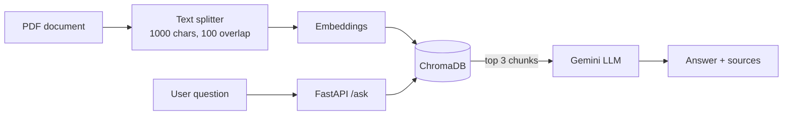

# Enterprise Document Intelligence Agent


An asynchronous **Retrieval-Augmented Generation (RAG)** API that answers questions from corporate documents. It retrieves the most relevant passages from a vector database and lets an LLM answer **only from those passages**, so answers stay grounded in the source document.

## Features

- **Grounded answers**: the LLM answers only from retrieved context and replies *"I don't know based on the document."* when the answer is not there.
- **Smart chunking**: LangChain `RecursiveCharacterTextSplitter` (1000-character chunks, 100-character overlap) to avoid losing meaning at chunk boundaries.
- **Persistent vector search**: embeddings stored and indexed in a local ChromaDB database.
- **Async API**: FastAPI endpoints with non-blocking retrieval and LLM calls.
- **Source transparency**: every answer returns the passages it was based on.
- **Containerized**: the full app runs in a single Docker container.

## Architecture



## Tech stack

| Layer | Technology |
|---|---|
| Language | Python 3.12 |
| RAG framework | LangChain (text splitters) |
| Vector database | ChromaDB (persistent, local) |
| LLM | Google Gemini API |
| API | FastAPI + Uvicorn |
| Packaging | Docker |

## Project structure

```
.
├── main.py              # FastAPI app: ingestion at startup + /ask endpoint
├── rag.py               # Standalone RAG script for quick testing
├── sample.pdf           # Sample document (fictional company handbook)
├── requirements.txt     # Python dependencies
├── Dockerfile           # Container definition
└── README.md
```

## Getting started

### 1. Run locally

```bash
git clone https://github.com/sahilgouda-ds/enterprise-document-intelligence-agent.git
cd enterprise-document-intelligence-agent

python -m venv .venv
.venv\Scripts\activate        # Windows
pip install -r requirements.txt
```

Create a `.env` file and add your free Gemini API key from [Google AI Studio](https://aistudio.google.com):

```
GEMINI_API_KEY=gemini_key
```

Start the server:

```bash
uvicorn main:app
```

Open **http://127.0.0.1:8000/docs** for the interactive API page.

### 2. Run with Docker

```bash
docker build -t doc-intel-agent .
docker run -p 8000:8000 --env-file .env doc-intel-agent
```

## API

| Method | Endpoint | Description |
|---|---|---|
| GET | `/health` | Health check, returns the number of indexed chunks |
| POST | `/ask` | Ask a